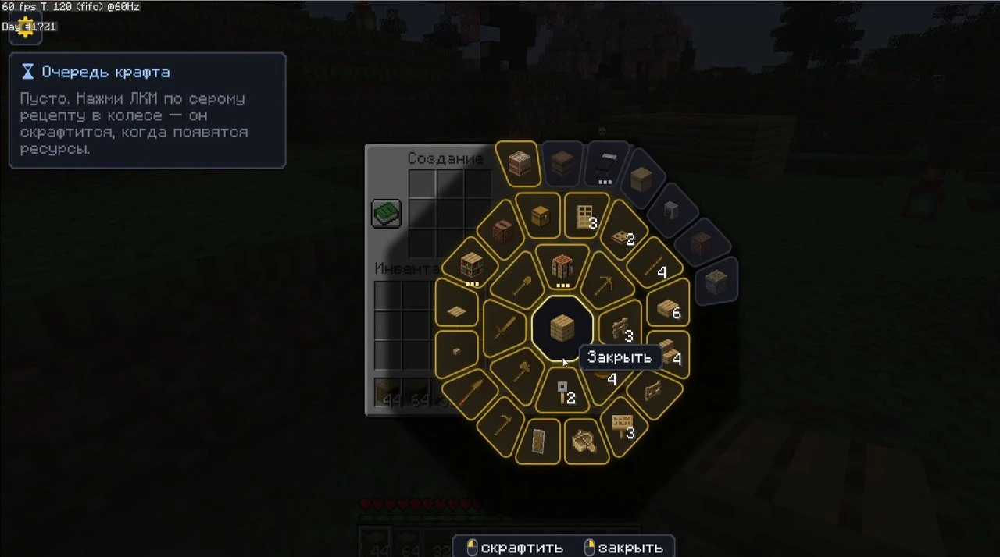
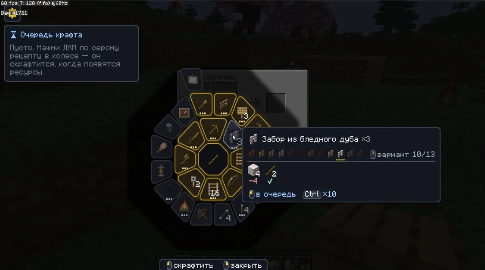
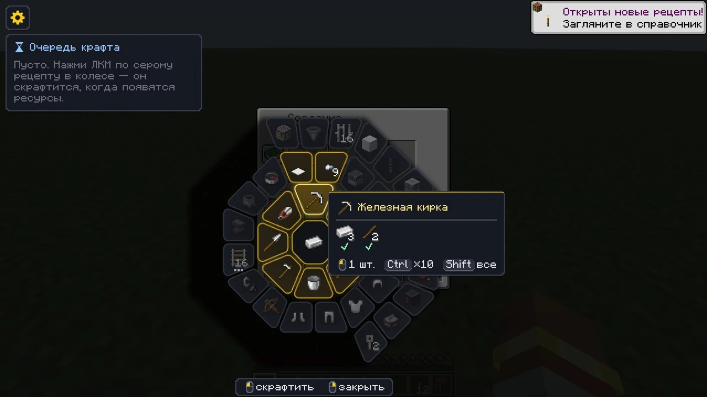
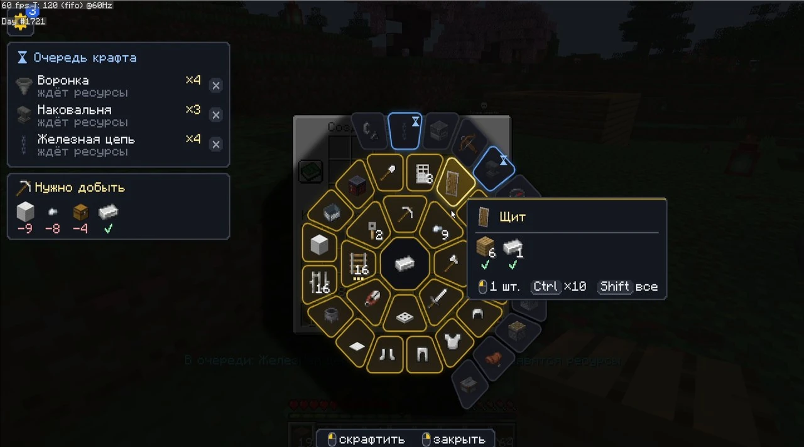

> **Language:** [Русский](README.md) · English

<div align="center">

  
  <h3>BeezzCraft (Extended)</h3>

</div>

<div align="center">


</div>

**Crafting wheel for Minecraft (Fabric and NeoForge).** **Alt + right click** an item in the inventory or at a crafting
table and an octagon wheel of everything you can craft from it opens. No need to remember recipes or page through the
recipe book.

> Made by BeezzLand with AI, and Mr712 ported it to every Minecraft version 1.21 – 26.3 with both loaders
> (Fabric and NeoForge)

## Gallery

| The wheel | Variants on the mouse wheel |
| :---: | :---: |
|  |  |

| Crafting table: iron pickaxe | Craft queue and "resources to get" |
| :---: | :---: |
|  |  |

| Settings |
| :---: |
|  |

## Features

- **Alt + right click** an item in the inventory (2×2 recipes) or at a crafting table (3×3): a wheel of everything it
  makes. Gold buttons mean the resources are there, grey ones mean something is missing.
- **Rings of 8, 16, 24 and 32 buttons**, up to 80 recipes per page; more go to the next pages (the «◀ 1/2 ▶» switch
  above the wheel or the mouse wheel).
- **Click** crafts once, **Ctrl + click** crafts 10 times, **Shift + click** crafts as many as possible.
- **Mouse wheel** over a button with variants: a fence of each wood, torch / soul torch / copper torch, the tiers of a
  tool. The mod remembers the variant you chose last.
- **Hover** a sector: a card with the result, the ingredients as icons (green tick = enough, red = how many are
  missing) and the clicks drawn as mouse and key pictures.
- **Every crafting recipe of the game**, even the ones the recipe book has not unlocked (a torch before a stone
  pickaxe). In singleplayer from the server, in multiplayer from the game's own data. Recipes the book knows are
  crafted through it; the others are laid out with ordinary clicks. Both work on vanilla servers.
- **Craft queue** (switched on behind the gear ⚙): clicking a grey recipe queues it, and it is crafted by itself as
  soon as the items are in your inventory. Only while nothing or your own inventory is open (never with a chest open).
  3×3 recipes wait for a crafting table.
- **"Resources to get"**: everything the queue still needs, in the inventory and on screen while playing.
- Russian and English.

## Installation

The mod runs on **Fabric** and **NeoForge**. Fabric API and other libraries are not required: the mod reads its textures and translations from its own JAR.

1. Install [Fabric Loader](https://fabricmc.net/use/) or [NeoForge](https://neoforged.net/) for Minecraft **1.21.4**.
2. Put one JAR for your loader into the `mods` folder:
   - `BeezzCraft-Fabric-1.21.4-v1.0.0.jar` — for Fabric;
   - `BeezzCraft-NeoForge-1.21.4-v1.0.0.jar` — for NeoForge.
3. Start the game.

The mod is client-only: it does not need to be installed on the server and works on ordinary (vanilla) servers.

## Controls

| Key | Action |
|---|---|
| `Alt + right click` on an item | Open the crafting wheel |
| `V + right click` on an item | Open the crafting wheel (reliable backup) |
| `Left click` a sector | Craft once |
| `Ctrl + left click` | Craft 10 times |
| `Shift + left click` | Craft as many as possible |
| `Right click` a sector | Remove it from the queue |
| Mouse wheel | Variants of the item / pages |
| `Esc` or the inventory key | Close the wheel |

> On Windows, holding Alt can make the game lose the Alt state: the wheel may not open and the item is split instead. Hold **V** and right-click the hovered item as a reliable backup.

## Where the settings live

All mod settings are in `.minecraft/config/beezzcraft.json`: the craft queue, grey recipes, "resources to get", the
crafting sound, the Ctrl count and the recently crafted items.

## Build

JDK 21 or newer is required; the build uses a Java 21 toolchain.

```bash
./gradlew build
```

The command builds both files into `build/libs/`:

- `BeezzCraft-Fabric-1.21.4-v1.0.0.jar`
- `BeezzCraft-NeoForge-1.21.4-v1.0.0.jar`

Client game tests with screenshots are available on 1.21.4 – 1.21.11 and 26.1 – 26.3; Fabric API has no
client-gametest module for 1.21 – 1.21.3.

## Authors and licenses

- **Mod author:** BeezzLand ([erkinpaw](https://github.com/erkinpaw/beezzcraft)) · **License:** [MIT](https://github.com/erkinpaw/beezzcraft/blob/main/LICENSE).
- **Port to Fabric/NeoForge 1.21 – 26.3:** [Mr712](https://github.com/byMr712/BeezzCraftExtended-MinecraftMod) · **License:** [MIT](LICENSE).
