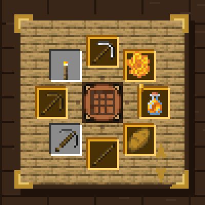
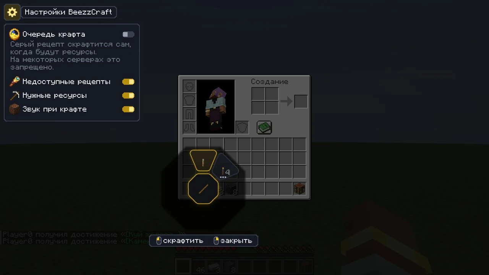

> **Language:** [Русский](README.md) · English

<div align="center">

  
  <h3>BeezzCraft (Extended)</h3>

</div>

<div align="center">


</div>

## _**Support only English and Russian language!**_

**BeezzCraft (Extended)** is a client-side crafting wheel for Minecraft with a compact octagon interface. **Ctrl + right click** an item in your inventory or at a crafting table and the wheel opens with everything you can craft from it. No need to remember recipes or page through the recipe book.

_**A video showing this mod and its features is available on [YouTube](https://youtu.be/uBgZQ2bAXQo?si=n4Jig1-TJIscap2_).**_

_**This mod was created by BeezzLand with the help of AI, and ported to Fabric and NeoForge by Mr712. I do not monetize on CurseForge — just enjoy the game!**_

_**If any issues arise, please write to me in the comments on CurseForge or open an issue on [GitHub](https://github.com/byMr712/BeezzCraftExtended-MinecraftMod/issues)!**_

*   [Telegram group for discussing this mod](https://t.me/BeezzCraftExtended/1)

## Gallery

| The wheel | Variants: mouse wheel or middle click |
| :---: | :---: |
|  |  |

| Crafting table: iron pickaxe | Craft queue and "resources to get" |
| :---: | :---: |
|  |  |

| Settings |
| :---: |
|  |

## What can this mod do?

### The Crafting Wheel

*   **Ctrl + right click** an item in the inventory (2×2 recipes) or at a crafting table (3×3): an octagon wheel of everything it makes.
*   **Gold sectors** mean the resources are there; **grey sectors** mean something is missing.
*   **Rings of 8, 16, 24 and 32 buttons** — up to 80 recipes per page. More recipes go to the next pages: use the page switcher above the wheel or the mouse wheel.
*   **Click** crafts once, **Ctrl + click** crafts 10 times, **Shift + click** crafts as many as possible.
*   **Hover a sector** for a card with the result, the ingredients as icons (green tick = enough, red = how many are missing) and the click controls drawn as mouse/key pictures.
*   The wheel opens around the mouse and shrinks automatically to fit small windows.
*   Close it with **Esc**, the inventory key, a click on the centre, or a click outside the wheel.
*   If there is nothing to craft from an item, the wheel does not open: a white hint appears above the inventory panel for 3 seconds.

### Recipes & Variants

*   **Every crafting recipe of the game**, even the ones the recipe book has not unlocked (a torch before a stone pickaxe).
*   Recipes the recipe book knows are crafted through it; the others are laid out with ordinary clicks. Both work on vanilla servers.
*   In singleplayer the recipes come from the integrated server; in multiplayer from the game's own data.
*   **Variants are grouped into one button:** fences of every wood, torch / soul torch / copper torch, tool tiers, and so on.
*   **Mouse wheel or middle click over a button with variants** cycles through them; middle click always moves to the next variant. The mod remembers the variant you crafted last.
*   If you have not crafted that item before, the wheel shows the variant you can craft, then the one from the wood further up-left in your inventory, then the one you lack the least for.
*   Craftable recipes come first; recipes you craft often and popular recipes are sorted higher.
*   Grey recipes can be hidden in the settings.

### Craft Queue

*   Turn the queue on behind the **gear button** in the top-left corner of the inventory or crafting table.
*   Click a grey recipe to queue it; it is crafted automatically as soon as the items are in your inventory.
*   **3×3 recipes wait for a crafting table.**
*   The queue runs while no other container is open — in the world, in your inventory or at a crafting table. It never runs with a chest or another container open.
*   The queue panel under the gear shows up to eight jobs with their status: *can be crafted*, *waiting for resources* or *needs a crafting table*. The × button removes a job.
*   Right-click a queued sector to remove it from the queue.
*   The gear shows the number of queued jobs.
*   While playing, a compact queue card on the HUD shows the queued items and their counts.

### Resources to Get

*   **"Resources to get"** adds up every ingredient of the queue and subtracts what your inventory already has.
*   Shown under the queue in the inventory and as a compact card on the HUD while playing.
*   Green ticks mean you have the resource; red numbers show how many are missing.
*   Can be switched off in the settings.

### Functional Key & Mod Menu

*   The wheel is opened by **Ctrl + right click** by default. The functional key can be changed to another key or mouse button.
*   **Mod Menu:** if Mod Menu is installed, open **Beezz Craft (Extended)** → **Configure**. At the top, the **Use the mod** switch turns the wheel, gear menu and craft queue off completely. Below it are the functional key, key-only mode, click button and gear position. Then a **Crafting & hints** section with the craft queue, unavailable recipes, "resources to get" and the crafting sound. The bottom row is **Reset**, **Save** and **Cancel**.
*   **Use only the functional key** — off by default. Hover an item and press the functional key to open the wheel without a mouse click.
*   **Functional click** — the mouse button used together with the functional key: **Left button** or **Right button** (default: Right button).
*   The same key bind is available in **Options → Controls → Key Binds → Beezz Craft Extended → Function key**.

### Settings

The gear button opens a small panel:

*   **Craft queue** — automatic crafting of grey recipes (off by default; some servers forbid it).
*   **Recipes you can't make** — show or hide grey sectors.
*   **Resources to get** — show or hide the queue's shopping list.
*   **Sound when crafting** — click sound on a craft.
*   **Key only**, **Click**, **Key** (click, then press a new key or mouse button) and **Settings** (gear position). Every row has a hover tooltip.

The **Ctrl count** is set in the config file (default 10). The mod remembers recently crafted items and craft counts; they are used for sorting and variant selection.

### Languages

English and Russian. Textures and translations are loaded from the mod's own JAR; Fabric API and other libraries are not required.

## Controls

| Action | Default control |
| --- | --- |
| Open the crafting wheel | <code>Ctrl + right click</code> an item |
| Open on the hovered item | <code>Functional key</code> (if "Use only the functional key" is on) |
| Craft once | <code>Left click</code> a sector |
| Craft 10 times | <code>Ctrl + left click</code> |
| Craft as many as possible | <code>Shift + left click</code> |
| Remove a queued recipe | <code>Right click</code> a sector |
| Switch variants | <code>Mouse wheel</code> over a sector |
| Next variant | <code>Middle click</code> a sector |
| Switch pages | <code>Mouse wheel</code> or the page switcher |
| Open settings | Gear button in the top-left corner |
| Open the mod config | <code>Mod Menu → BeezzCraft (Extended) → Configure</code> |
| Change the functional key | <code>Options → Controls → Key Binds → Beezz Craft Extended</code> |
| Close the wheel | <code>Esc</code>, inventory key, centre or outside click |

## Configuration

Settings are stored in `config/beezzcraft.json` and can be edited in-game from the gear button or the Mod Menu config screen.

```json
{
  "queue": false,
  "showMissing": true,
  "sound": true,
  "showNeeds": true,
  "keyOnly": false,
  "functionalClick": 1,
  "ctrlCount": 10,
  "recent": [],
  "counts": {}
}
```

*   `queue` — craft grey recipes automatically when the resources appear (off by default).
*   `showMissing` — show grey recipes that cannot be crafted yet.
*   `sound` — play a click sound when crafting.
*   `showNeeds` — show the "resources to get" card.
*   `keyOnly` — open the wheel by pressing the functional key alone on a hovered item (off by default).
*   `functionalClick` — mouse button used with the functional key: `0` = left, `1` = right (default `1`).
*   `ctrlCount` — number of crafts per Ctrl + click (at least 2).
*   `recent` and `counts` — remembered automatically; used to show recently and often crafted items first.

## Supported Versions

The mod is available for **Fabric** and **NeoForge**:

*   **26.3, 26.2, 26.1.2, 26.1.1, 26.1**
*   **1.21.11, 1.21.10, 1.21.9, 1.21.8, 1.21.7, 1.21.6**
*   **1.21.5, 1.21.4, 1.21.3, 1.21.2, 1.21.1, 1.21**

No additional libraries are required. Client-side only: install it on your client, it works on any server.

## Installation

1. Install [Fabric Loader](https://fabricmc.net/use/) or [NeoForge](https://neoforged.net/) for your Minecraft version.
2. Put the matching JAR into the `mods` folder:
   - `BeezzCraft-Fabric-<version>-v1.1.jar` — for Fabric;
   - `BeezzCraft-NeoForge-<version>-v1.1.jar` — for NeoForge.
3. Start the game.

Mod Menu is optional; install it to get the in-game config screen.

## Build

JDK 25 or newer is required.

```bash
./gradlew build
```

The command builds both files into `build/libs/`:

- `BeezzCraft-Fabric-1.21.7-v1.1.jar`
- `BeezzCraft-NeoForge-1.21.7-v1.1.jar`

Client game tests with screenshots are available on 1.21.4 – 1.21.11 and 26.1 – 26.3; Fabric API has no client-gametest module for 1.21 – 1.21.3.

## Credits & License

*   **Original mod:** BeezzLand ([erkinpaw](https://github.com/erkinpaw/beezzcraft)).
*   **Port to Fabric/NeoForge for 1.21–26.3:** [Mr712](https://github.com/byMr712/BeezzCraftExtended-MinecraftMod).
*   **GitHub:** [BeezzCraftExtended-MinecraftMod](https://github.com/byMr712/BeezzCraftExtended-MinecraftMod).
*   Distributed under the [MIT License](https://github.com/byMr712/BeezzCraftExtended-MinecraftMod/blob/1.21.7/LICENSE).
