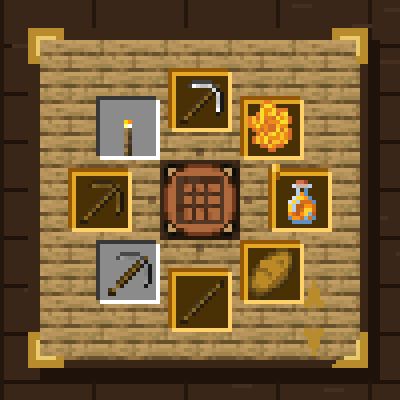
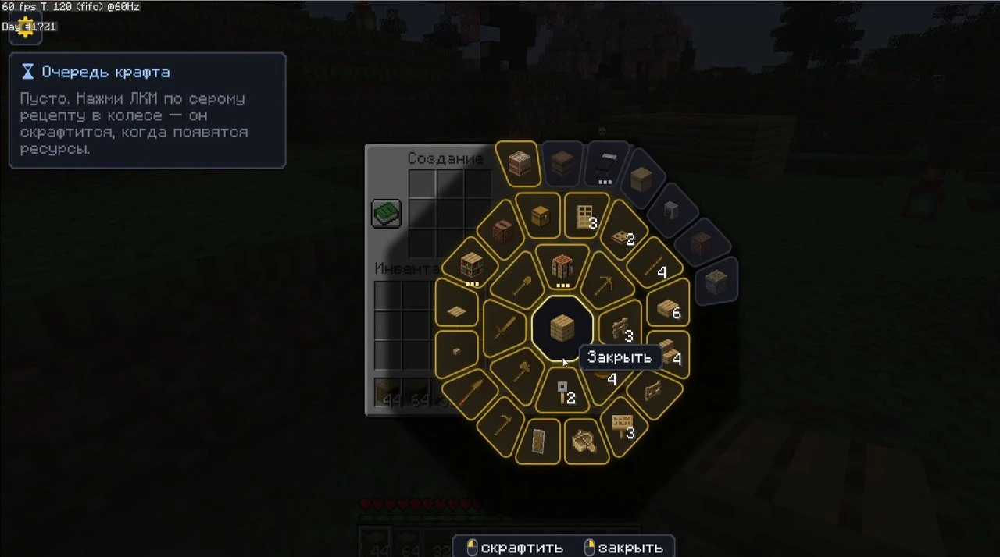
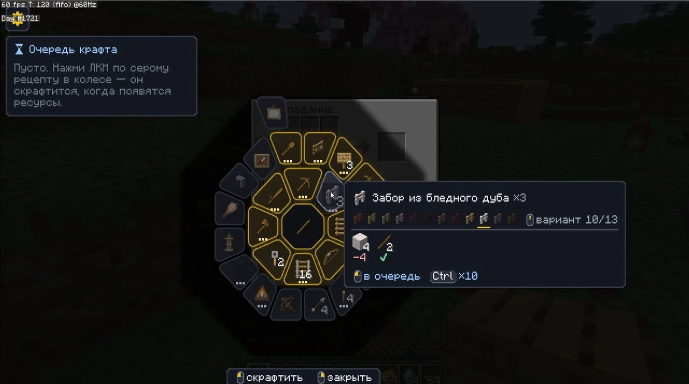
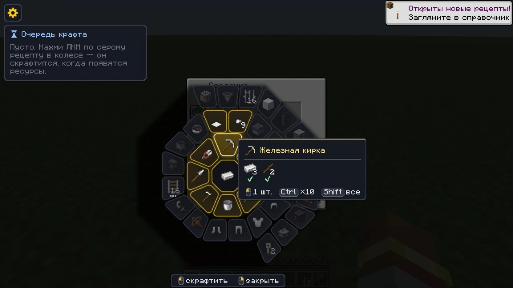
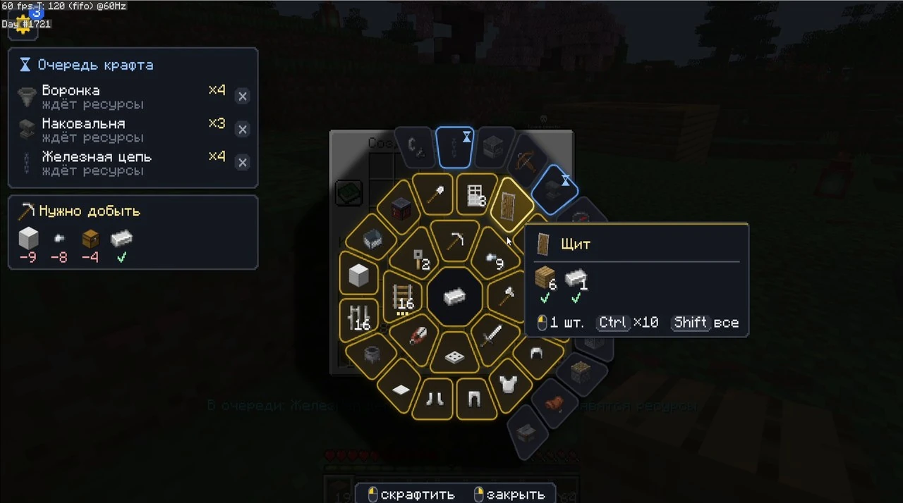
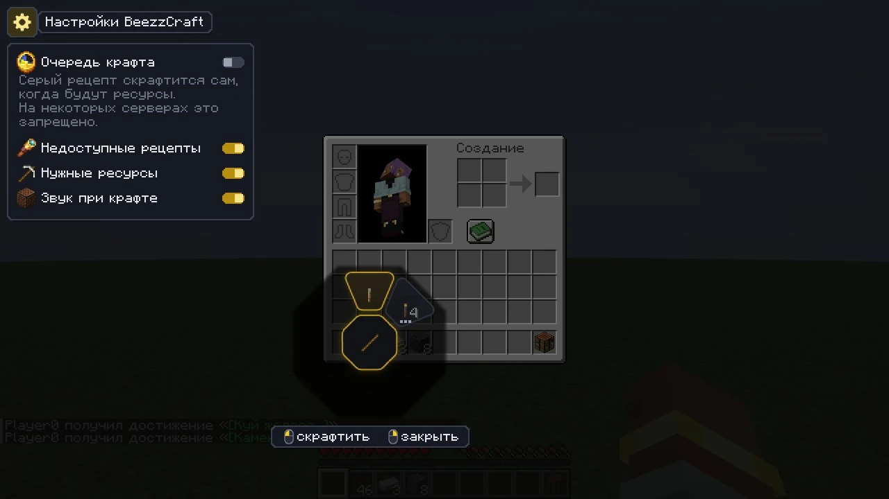

> **Язык:** Русский · [English](README.en.md)

<div align="center">

  
  <h3>BeezzCraft (Extended)</h3>

</div>

<div align="center">


</div>

## _**Поддерживаются только английский и русский языки!**_

**BeezzCraft (Extended)** — клиентское колесо крафта для Minecraft с компактным восьмиугольным интерфейсом. **Ctrl + ПКМ** по предмету в инвентаре или на верстаке — и открывается колесо со всем, что из него можно скрафтить. Больше не нужно помнить рецепты и листать книгу рецептов.

_**Видео о моде и его возможностях доступно на [YouTube](https://youtu.be/uBgZQ2bAXQo?si=n4Jig1-TJIscap2_).**_

_**Мод создан BeezzLand с помощью AI и портирован на Fabric и NeoForge автором Mr712. Я не монетизирую CurseForge — просто играйте в своё удовольствие!**_

_**Если возникнут проблемы, напишите мне в комментариях на CurseForge или создайте issue на [GitHub](https://github.com/byMr712/BeezzCraftExtended-MinecraftMod/issues)!**_

*   [Telegram-группа для обсуждения мода](https://t.me/BeezzCraftExtended/1)

## Галерея

| Колесо | Варианты: колёсико или средний клик |
| :---: | :---: |
|  |  |

| Верстак: железная кирка | Очередь крафта и «Что добыть» |
| :---: | :---: |
|  |  |

| Настройки |
| :---: |
|  |

## Что умеет мод?

### Колесо крафта

*   **Ctrl + ПКМ** по предмету в инвентаре (рецепты 2×2) или на верстаке (3×3) — восьмиугольное колесо со всем, что из него можно сделать.
*   **Золотые сектора** — ресурсов достаточно; **серые** — чего-то не хватает.
*   **Кольца на 8, 16, 24 и 32 кнопки** — до 80 рецептов на странице. Остальные рецепты — на следующих страницах: переключатель над колесом или колёсико мыши.
*   **Клик** крафтит один раз, **Ctrl + клик** — 10 раз, **Shift + клик** — сколько получится.
*   **Наведение на сектор** показывает карточку с результатом, ингредиентами (зелёная галочка — хватает, красное число — сколько не хватает) и подсказками по кликам.
*   Колесо открывается вокруг курсора и автоматически уменьшается, чтобы поместиться в маленьком окне.
*   Закрыть: **Esc**, клавиша инвентаря, клик по центру или клик вне колеса.
*   Если из предмета нечего скрафтить, колесо не открывается: над панелью инвентаря на 3 секунды появляется белая подсказка.

### Рецепты и варианты

*   **Все рецепты крафта игры**, даже те, что ещё не открыты в книге рецептов (например, факел до каменной кирки).
*   Рецепты, известные книге, крафтятся через неё; остальные раскладываются обычными кликами. Работает на ванильных серверах.
*   В одиночной игре рецепты берутся с интегрированного сервера, в мультиплеере — из данных игры.
*   **Варианты объединяются в одну кнопку:** заборы из каждого дерева, факел / факел душ / медный факел, уровни инструментов и так далее.
*   **Колёсико мыши или средний клик над кнопкой с вариантами** переключают их; средний клик всегда переключает на следующий вариант. Мод запоминает последний скрафченный вариант.
*   Если предмет ещё не крафтился, колесо показывает вариант, который можно скрафтить, затем вариант из дерева выше и левее в инвентаре, затем тот, которого не хватает меньше всего.
*   Сначала идут доступные рецепты; часто создаваемые и популярные — выше.
*   Серые рецепты можно скрыть в настройках.

### Очередь крафта

*   Включите очередь за **кнопкой-шестерёнкой** в левом верхнем углу инвентаря или верстака.
*   Нажмите на серый рецепт, чтобы поставить его в очередь; он скрафтится сам, когда появятся ресурсы.
*   **Рецепты 3×3 ждут верстака.**
*   Очередь работает, пока не открыт другой контейнер — в мире, в инвентаре или на верстаке. С открытым сундуком или другим контейнером она не работает.
*   Панель очереди под шестерёнкой показывает до восьми задач и их состояние: *можно скрафтить*, *ждёт ресурсы* или *нужен верстак*. Кнопка × убирает задачу.
*   ПКМ по сектору в очереди убирает его из очереди.
*   Шестерёнка показывает количество задач в очереди.
*   Во время игры компактная карточка очереди на HUD показывает предметы и их количество.

### Что добыть

*   **«Что добыть»** суммирует все ингредиенты очереди и вычитает то, что уже есть в инвентаре.
*   Показывается под очередью в инвентаре и компактной карточкой на HUD во время игры.
*   Зелёные галочки — ресурс есть; красные числа — сколько не хватает.
*   Можно отключить в настройках.

### Функциональная клавиша и Mod Menu

*   Колесо открывается комбинацией **Ctrl + ПКМ** по умолчанию. Функциональную клавишу можно переназначить на другую клавишу или кнопку мыши.
*   **Mod Menu:** если установлен Mod Menu, откройте **BeezzCraft (Extended)** → **Configure**. На экране есть функциональная клавиша, режим «только клавиша» и кнопка функционального клика.
*   **Использовать только функциональную клавишу** — выключено по умолчанию. Наведите курсор на предмет и нажмите функциональную клавишу, чтобы открыть колесо без клика мышью.
*   **Функциональный клик** — кнопка мыши вместе с функциональной клавишей: **Левая кнопка** или **Правая кнопка** (по умолчанию правая).
*   Тот же keybind доступен в **Настройки → Управление → Назначения клавиш → Beezz Craft Extended → Функциональная клавиша**.

### Настройки

Кнопка-шестерёнка открывает небольшую панель:

*   **Очередь крафта** — автоматический крафт серых рецептов (по умолчанию выключено; некоторые серверы это запрещают).
*   **Недоступные рецепты** — показывать или скрывать серые сектора.
*   **Нужные ресурсы** — показывать или скрывать список покупок очереди.
*   **Звук при крафте** — звук клика при крафте.

**Количество крафтов по Ctrl** задаётся в конфиге (по умолчанию 10). Мод запоминает недавно скрафченные предметы и количество крафтов; они используются для сортировки и выбора вариантов.

### Языки

Английский и русский. Текстуры и переводы загружаются из JAR мода; Fabric API и другие библиотеки не требуются.

## Управление

| Действие | Управление по умолчанию |
| --- | --- |
| Открыть колесо крафта | <code>Ctrl + ПКМ</code> по предмету |
| Открыть на предмете под курсором | <code>Функциональная клавиша</code> (если включено «Использовать только функциональную клавишу») |
| Скрафтить один раз | <code>ЛКМ</code> по сектору |
| Скрафтить 10 раз | <code>Ctrl + ЛКМ</code> |
| Скрафтить сколько получится | <code>Shift + ЛКМ</code> |
| Убрать рецепт из очереди | <code>ПКМ</code> по сектору |
| Переключить варианты | <code>Колёсико мыши</code> над сектором |
| Следующий вариант | <code>Средний клик</code> по сектору |
| Переключить страницы | <code>Колёсико мыши</code> или переключатель страниц |
| Открыть настройки | Кнопка-шестерёнка в левом верхнем углу |
| Открыть конфиг мода | <code>Mod Menu → BeezzCraft (Extended) → Configure</code> |
| Изменить функциональную клавишу | <code>Настройки → Управление → Назначения клавиш → Beezz Craft Extended</code> |
| Закрыть колесо | <code>Esc</code>, клавиша инвентаря, центр или клик вне колеса |

## Конфигурация

Настройки хранятся в `config/beezzcraft.json`; их можно менять через шестерёнку или экран Mod Menu.

```json
{
  "queue": false,
  "showMissing": true,
  "sound": true,
  "showNeeds": true,
  "keyOnly": false,
  "functionalClick": 1,
  "ctrlCount": 10,
  "recent": [],
  "counts": {}
}
```

*   `queue` — автоматически крафтить серые рецепты при появлении ресурсов (по умолчанию выключено).
*   `showMissing` — показывать серые рецепты, которые пока нельзя скрафтить.
*   `sound` — звук клика при крафте.
*   `showNeeds` — показывать карточку «Что добыть».
*   `keyOnly` — открывать колесо нажатием только функциональной клавиши на предмете под курсором (по умолчанию выключено).
*   `functionalClick` — кнопка мыши вместе с функциональной клавишей: `0` — левая, `1` — правая (по умолчанию `1`).
*   `ctrlCount` — количество крафтов по Ctrl + клик (не меньше 2).
*   `recent` и `counts` — запоминаются автоматически; используются для сортировки и выбора вариантов.

## Поддерживаемые версии

Мод доступен для **Fabric** и **NeoForge**:

*   **26.3, 26.2, 26.1.2, 26.1.1, 26.1**
*   **1.21.11, 1.21.10, 1.21.9, 1.21.8, 1.21.7, 1.21.6**
*   **1.21.5, 1.21.4, 1.21.3, 1.21.2, 1.21.1, 1.21**

Дополнительные библиотеки не нужны. Мод клиентский: установите его на клиент, он работает на любом сервере.

## Установка

1. Установите [Fabric Loader](https://fabricmc.net/use/) или [NeoForge](https://neoforged.net/) для своей версии Minecraft.
2. Положите подходящий JAR в папку `mods`:
   - `BeezzCraft-Fabric-<version>-v1.1.jar` — для Fabric;
   - `BeezzCraft-NeoForge-<version>-v1.1.jar` — для NeoForge.
3. Запустите игру.

Mod Menu необязателен; установите его, чтобы получить экран настроек в игре.

## Сборка

Нужен JDK 25 или новее.

```bash
./gradlew build
```

Команда собирает оба файла в `build/libs/`:

- `BeezzCraft-Fabric-1.21.5-v1.1.jar`
- `BeezzCraft-NeoForge-1.21.5-v1.1.jar`

Игровые тесты со скриншотами доступны в ветках 1.21.4 – 1.21.11 и 26.1 – 26.3; в Fabric API для 1.21 – 1.21.3 нет client-gametest модуля.

## Авторы и лицензии

*   **Оригинальный мод:** BeezzLand ([erkinpaw](https://github.com/erkinpaw/beezzcraft)).
*   **Порт на Fabric/NeoForge для 1.21–26.3:** [Mr712](https://github.com/byMr712/BeezzCraftExtended-MinecraftMod).
*   **GitHub:** [BeezzCraftExtended-MinecraftMod](https://github.com/byMr712/BeezzCraftExtended-MinecraftMod).
*   Распространяется по [лицензии MIT](https://github.com/byMr712/BeezzCraftExtended-MinecraftMod/blob/1.21.5/LICENSE).
